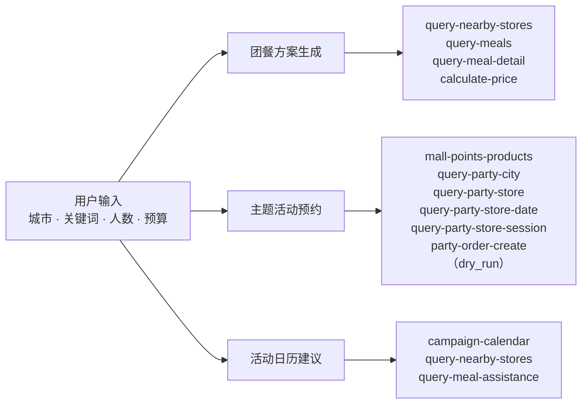

# mcd-party-planner · 麦当劳聚会 / 团餐组织助手

> 基于 **麦当劳 MCP** 真实能力的 Skill：输入「城市 + 关键词 + 人数 + 预算」，
> 输出多套**真实计价**的团餐方案；串联主题活动（派对 / 品鉴会）预约链路；
> 结合活动日历与附近门店给出组织时机建议。
>
> 参赛作品 —— 麦当劳程序员节创意开发大赛（2026 · 1024 程序员节）。

[](https://github.com/zcbacxc/mcd-party-planner/actions/workflows/ci.yml)
[](https://github.com/zcbacxc/mcd-party-planner/releases)
[](https://www.python.org/)
[](./LICENSE)
[](https://github.com/M-China/mcd-mcp-server)
[](#5-环境要求)

---

## 30 秒看懂

**一句话**：你说「成都春熙路，8 个人，预算 400」，它去麦当劳 MCP 查附近营业门店、拉真实菜单、用官方计价接口算钱，给你几套含人均的可比对方案——顺手把派对场次和附近活动也查了。

```bash
cp .env.example .env      # 填 MCD_MCP_TOKEN（open.mcd.cn 免费申请）
python -m src.cli plan --city 成都 --keyword 春熙路 --headcount 8 --budget 400
```

```text
【团餐方案】城市：成都　关键词：春熙路　人数：8　预算：¥400.0
已扫描门店：2　可选方案：6　预算内方案：1
1. [经济型] 麦当劳成都锦江区联升巷(京都大厦)餐厅　合计 ¥342.4　人均 ¥42.8　预算内
推荐：[经济型] 麦当劳成都锦江区联升巷(京都大厦)餐厅，合计 ¥342.4，人均 ¥42.8
```

> 上为 **2026-10-20 真实调用**输出（有删节）。服务端菜单与价格按日轮换，复跑结果会不同——这属正常，不是模拟数据。

三个场景如何串联：



- **不编价格**：金额一律来自 `calculate-price`，遇限购等业务限制就跳过并提示；
- **不误下单**：主题预约默认 `dry_run`，只给可下单载荷，加 `--confirm` 才真实下单；
- **不重复下单**：写操作（下单 / 建址 / 取消）遇 5xx 不自动重试，只对 429 重试；
- **零依赖**：纯 Python 标准库，Python 3.9+，不需要 `pip install`。

---

## 一、项目介绍

组织一次多人麦当劳聚餐，真正麻烦的不是点什么，而是三件事同时算清楚：**附近哪家门店能吃、多少人吃什么组合、总共花多少钱不超预算**。

`mcd-party-planner` 把这三件事交给麦当劳 MCP 的真实数据（共接入 **15 个 Tool**）：

| 能力 | 说明 |
|---|---|
| **团餐方案生成** | 查附近营业中门店 → 拉真实菜单 → 按「经济型 / 均衡型 / 丰盛型」组装 → 用 `calculate-price` 真实计价，输出 ≥2 套含「合计 / 人均 / 是否超预算」的可比对方案 |
| **主题活动预约** | 自动串联 `派对商品 → 城市 → 门店 → 日期 → 场次` 五级查询，输出可直接下单的载荷；**默认 dry_run，不真实下单** |
| **活动日历组织建议** | 活动日历（往期 / 今日 / 未来）× 附近门店交叉，给出组织时机建议，并提示企业团餐助餐服务可用性 |

设计原则：**数据全部实时取自麦当劳 MCP，仓库内不含任何静态菜单或价格快照**；用户输入（城市、关键词、人数、预算）仅存在于运行时内存、不落盘；其中**城市与关键词会随查询参数发往麦当劳 MCP**，除此之外不向任何第三方外发。

> 调用层内置滑动窗口节流器（默认 300 次/分钟，官方上限 600）与 429 指数退避，批量比对不会触发限流。

---

## 二、安装方法

### 1. 申请 MCP Token

访问 [麦当劳 MCP 开放平台](https://open.mcd.cn/mcp) → 手机号验证登录 → 右上角「控制台」→「激活」→ 同意服务协议 → 复制 Token。

### 2. 获取代码

```bash
git clone https://github.com/zcbacxc/mcd-party-planner.git
cd mcd-party-planner
```

### 3. 配置 Token

```bash
cp .env.example .env
# 编辑 .env，填入：MCD_MCP_TOKEN=你的Token
```

> `.env` 已被 `.gitignore` 排除，**绝不会提交到仓库**。仓库中的 `mcp-config.example.json` 只含环境变量占位符。

### 4. 在 WorkBuddy 中使用（可选）

本项目主交付形态即 WorkBuddy Skill（见 [`skill/SKILL.md`](./skill/SKILL.md)）。按 `mcp-config.example.json` 在 WorkBuddy 的【自定义连接器】中启用 `mcd-mcp` 后，直接用自然语言描述聚餐需求即可。

### 5. 环境要求

- Python 3.9 及以上，**仅依赖标准库，无需 pip 安装任何包**。

### 6. 自检

```bash
python -m src.cli selfcheck
```

```text
=== 环境自检 ===
MCD_MCP_TOKEN: 已配置
tokenLength: 32
MCD_MCP_ENDPOINT: https://mcp.mcd.cn
结论：Token 已就绪，可执行真实调用
```

---

## 三、使用示例

> 以下输出均为**真实调用麦当劳 MCP** 的结果（成都 · 春熙路）。
> **服务端商品与价格按日轮换**，因此每条示例都标注了实测日期——复跑结果与示例不同属正常现象，不是模拟数据。

### 示例 1：8 人聚餐，预算 400 元（2026-10-16 实测）

```bash
python -m src.cli plan --city 成都 --keyword 春熙路 --headcount 8 --budget 400
```

```text
【团餐方案】
城市：成都　关键词：春熙路　人数：8　预算：¥400.0
已扫描门店：2　可选方案：4　预算内方案：1

1. [经济型] 麦当劳成都锦江总府路茂业百货餐厅　合计 ¥352.0　人均 ¥44.0　预算内
   构成：精选单人餐三件套×8、小杯鲜萃咖啡×8
2. [经济型] 麦当劳成都壹购广场餐厅　合计 ¥444.0　人均 ¥55.5　超预算
   构成：精选单人餐三件套×8、冰浓浓黑巧中杯×8
3. [均衡型] 麦当劳成都锦江总府路茂业百货餐厅　合计 ¥591.2　人均 ¥73.9　超预算
   构成：精选单人餐三件套×8、龙焰芝士棒鸡腿堡三件套×8、小杯鲜萃咖啡×8
4. [均衡型] 麦当劳成都壹购广场餐厅　合计 ¥683.2　人均 ¥85.4　超预算
   构成：精选单人餐三件套×8、龙焰芝士棒鸡腿堡三件套×8、冰浓浓黑巧中杯×8

推荐：[经济型] 麦当劳成都锦江总府路茂业百货餐厅，合计 ¥352.0，人均 ¥44.0
！提示：门店 … / 丰盛型 计价失败：每单限购1件，去看看其他餐品吧
```

> `--json` 输出结构化结果；`--store-limit` 控制比对门店数。
> 注：部分餐品存在「每单限购 1 件」等业务限制，这类组合会以提示形式跳过，不编造价格。

### 示例 2：预约派对 / 品鉴会（默认不下单，2026-10-16 实测）

```bash
python -m src.cli party --city 成都市 --headcount 6
```

```text
【主题活动预约】
主题：麦当劳奇妙生日派对（spuId=1779）
城市：成都市　门店：麦当劳成都高新区大魔方餐厅（3450261）
日期：2026-10-16　场次：12:00-13:30　余位：12　价格：¥50.0
调用链路：mall-points-products → query-party-city → query-party-store
          → query-party-store-date → query-party-store-session
下单载荷：{'partyType': 1, 'spuId': 1779, 'skuId': 2027, 'storeCode': '3450261', …}
dry_run=True：未真实下单，仅输出可下单载荷
```

需真实下单时显式确认：

```bash
python -m src.cli party --city 成都市 --headcount 6 --confirm
```

### 示例 3：活动日历 × 附近门店（2026-10-16 实测）

```bash
python -m src.cli calendar --city 成都 --keyword 春熙路
```

```text
【活动日历组织建议】
城市：成都　关键词：春熙路　附近门店：2

· 2026-10-25　2026年10月25日
  活动：🫐一口爆汁！蓝莓爆爆珠麦旋风上新
  建议：未来活动，建议提前 3–5 天预约主题活动场次并预排团餐
· 2026-10-16　2026年10月16日 今日
  活动：麦当劳 X PEACEMINUSONE
  建议：今日可参与，建议立即组织；优先锁定 2 家附近门店的团餐方案

企业团餐助餐服务：
· 麦当劳成都府青路(恒大)餐厅：支持 保鲜速达
· 麦当劳成都三友路得来速餐厅：支持 保鲜速达
```

### 示例 4：校准工具入参（开发者，命令与当前版本一致）

```bash
python -m src.cli probe    # 拉取服务端 inputSchema → docs/mcp-schema.json
```

---

## 四、目标用户

| 用户 | 场景 | 得到的价值 |
|---|---|---|
| **团建 / 班级活动组织者** | 10–30 人聚餐，有明确预算上限 | 十几秒内得到多套含人均对比的真实报价方案，不再手工凑单 |
| **企业行政 / 团餐负责人** | 需确认门店是否支持团餐助餐服务 | 一次查询拿到附近门店的助餐服务可用性（保鲜速达 / 专人分餐等）与组织建议 |
| **想办派对的家长 / 会员** | 生日派对、品鉴会预约路径深 | 自动串联五级查询，输出可下单的场次与余位 |
| **MCP / Agent 开发者** | 想看一个 Skill 如何真实编排 15 个 MCP Tool | 可复用的调用层：节流、退避、结果解析、字段归一化与单一校准点 |

---

## 五、目录结构

```text
mcd-party-planner/
├── README.md                  # 项目介绍、安装、示例、目标用户
├── CONTEST_DECLARATION.md     # 参赛声明（官方原文，内容不可改动）
├── MCP_INTEGRATION.md         # MCP Server / Tool / 调用流程 / 业务价值
├── mcp-config.example.json    # 脱敏 MCP 配置示例（仅占位符）
├── workbuddy.md               # WorkBuddy 开发对话上下文
├── skill/SKILL.md             # WorkBuddy Skill 定义
├── src/
│   ├── mcp_client.py          # MCP 调用层：streamablehttp + Bearer + 节流 + 429 退避
│   ├── party_planner.py       # 业务逻辑层：三个核心场景
│   ├── config.py              # 本地配置读取（Token 不入仓）
│   └── cli.py                 # 命令行入口
└── tests/
    ├── test_mcp_client.py     # 调用层单元测试
    ├── test_party_planner.py  # 业务层单元测试
    ├── test_cli.py            # 命令行契约测试（参数、退出码、输出格式）
    └── smoke.py               # 真实 MCP 端到端冒烟（Token 缺失时自动跳过）
```

## 六、运行测试

```bash
python -m unittest discover -s tests -p "test_*.py"   # 单元测试 99 项（无需 Token）
python tests/smoke.py                                  # 端到端冒烟（需真实 Token）
```

> **CI 覆盖范围（请勿误读绿勾）**：GitHub Actions 在 Python 3.9–3.13 上执行上述**离线单元测试**；
> 真实 MCP 冒烟需要仓库配置 `MCD_MCP_TOKEN` Secret，未配置时该步骤会被跳过，
> 汇总门禁会以 warning 标注「本次仅验证离线单测」。
> 因此「CI 绿」= 单元测试通过，**不等于**真实链路已验证；后者以本地 `tests/smoke.py` 为准。

开发设置、代码风格与提交约定见 [`docs/CONTRIBUTING.md`](./docs/CONTRIBUTING.md)；
版本变更记录见 [`CHANGELOG.md`](./CHANGELOG.md)。

## 七、说明与免责

- 本项目为麦当劳程序员节创意开发大赛参赛作品，由参赛者独立开发，**非麦当劳官方产品**；
- 餐品信息、价格及供应状态以麦当劳官方渠道的实时结果为准；涉及营养或热量的输出仅供参考，**不构成医疗、营养或其他专业建议**；
- 部分餐品存在限购等业务限制，相关组合会被跳过并提示，不会输出估算价格；
- 使用本项目须遵守《麦当劳 MCP 服务规则》及麦当劳中国《使用条款》。

## 八、许可证

MIT，见 [LICENSE](./LICENSE)。
